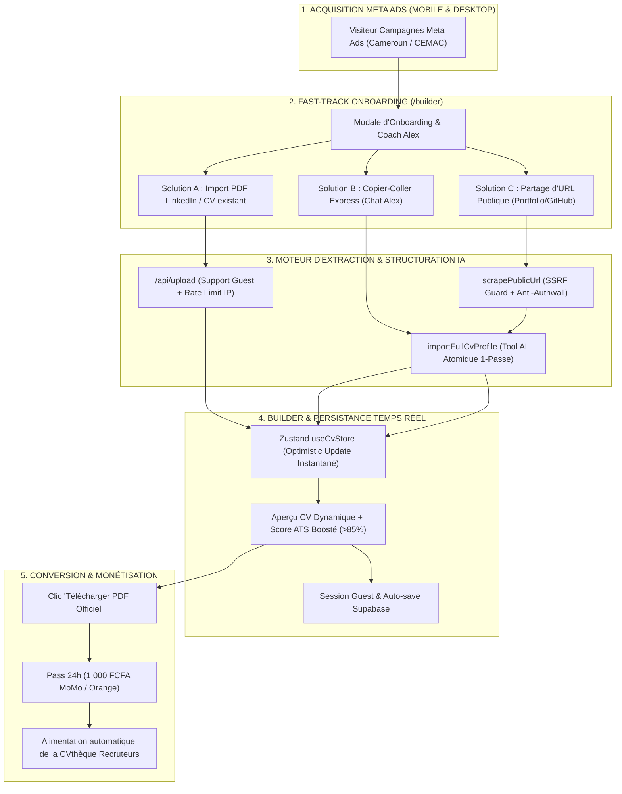

# Plan d'Implémentation Détaillé : Fast-Track Profile Import (Solutions A, B et C)

> **For Claude / Antigravity :** REQUIRED SUB-SKILL: Use `superpowers:executing-plans` to implement this plan task-by-task.
> 
> **Objectif :** Réduire à zéro la friction de saisie pour les visiteurs des publicités Meta Ads arrivant sur `/builder`, en permettant à Coach Alex et au Builder d'importer et structurer instantanément leur profil professionnel depuis un export PDF LinkedIn (Solution A), un copier-coller de texte brut (Solution B) ou une URL publique de portfolio/web (Solution C), tout en respectant l'architecture de session invité (Guest Checkout), la sécurité SSRF et le modèle économique d'AuthentiCV.
> 
> **Architecture :** Écosystème hybride unifié Next.js 15 (App Router) + Zustand + Vercel AI SDK + Claude 3.5 Haiku/Sonnet + Upstash Redis (Rate Limiting) + Supabase (Guest/Auth) + CamPay (Mobile Money).
> 
> **Tech Stack :** Next.js 15, TypeScript, Tailwind CSS, Vercel AI SDK (`ai`), `@ai-sdk/anthropic`, Zustand, Zod, pdf-parse, mammoth, cheerio / DOMPurify, Upstash Redis, Supabase.

---

## 🏗️ 1. Vue d'Ensemble de l'Écosystème & Flux Utilisateur



---

## 📋 2. Découpage Détaillé des Tâches d'Implémentation

---

### 🟢 PHASE 1 : Solution A — Déverrouillage Guest & Intégration Native LinkedIn PDF

#### Contexte & Défi
Actuellement, `/api/upload` bloque tout utilisateur non authentifié avec une erreur `401 Unauthorized`. Un internaute issu d'une pub Facebook qui clique sur "Importer un CV" sans avoir créé de compte est donc bloqué. De plus, aucun bouton d'upload direct n'est visible dans le chat avec Coach Alex ni mis en avant en haut de la modale d'accueil.

---

#### Tâche 1.1 : Ouvrir `/api/upload` aux invités avec limitation IP
* **Fichiers :**
  * Modifier : `authenticv/src/app/api/upload/route.ts`
* **Objectifs :**
  1. Permettre aux utilisateurs non connectés (`guest`) d'analyser leur CV/PDF.
  2. Remplacer la condition stricte `if (!user) return 401` par un identifiant de limitation hybride : `const rateLimitKey = user ? user.id : guest:${clientIp}`.
  3. Appliquer la limitation `uploadRateLimit` basée sur l'IP pour protéger le coût des tokens Anthropic Haiku.
* **Code à intégrer dans `route.ts` :**
```typescript
const clientIp = req.headers.get("x-forwarded-for")?.split(",")[0]?.trim() || "guest_ip";
const rateLimitKey = user ? user.id : `guest:${clientIp}`;
const { success: uploadOk } = await uploadRateLimit.limit(rateLimitKey);
if (!uploadOk) {
  return NextResponse.json(
    { error: "Limite de téléchargements atteinte. Veuillez patienter une minute." },
    { status: 429 }
  );
}
```

---

#### Tâche 1.2 : Bouton d'attachement direct dans le Chat d'Alex (`ChatInputArea.tsx`)
* **Fichiers :**
  * Modifier : `authenticv/src/components/chat/ChatInputArea.tsx`
  * Modifier : `authenticv/src/components/ChatPanel.tsx`
* **Objectifs :**
  1. Ajouter un bouton trombone/upload 📎 à gauche ou à droite du micro dans `ChatInputArea.tsx`.
  2. Permettre à l'utilisateur de cliquer dessus pour sélectionner son PDF LinkedIn ou ancien CV directement depuis le chat mobile ou desktop.
  3. Déclencher un upload vers `/api/upload` avec affichage d'un état de chargement élégant.
  4. Dès réception du JSON :
     - Mettre à jour `useCvStore.setCvData`.
     - Injecter automatiquement un message d'Alex dans la discussion :  
       *« J'ai bien analysé votre document ! J'ai extrait vos expériences, formations et compétences. Tout est pré-rempli sur votre écran. Que souhaitez-vous perfectionner ? »*

---

#### Tâche 1.3 : Mise en avant de l'Import LinkedIn dans `OnboardingModal.tsx`
* **Fichiers :**
  * Modifier : `authenticv/src/components/OnboardingModal.tsx`
* **Objectifs :**
  1. Insérer un bandeau prioritaire en tête de la modale d'onboarding :
     - Titre : `⚡ Vous avez déjà un profil LinkedIn ou un ancien CV ?`
     - Sous-titre : `Gagnez du temps : importez-le en 1 clic pour pré-remplir instantanément votre CV.`
     - Bouton d'action : `📁 Déposer mon fichier (PDF, Word)`
     - Bulle d'aide : `Sur LinkedIn : Profil > Plus (...) > Enregistrer au format PDF.`
  2. Si l'utilisateur clique sur ce bouton, il sélectionne son fichier, l'onboarding se ferme et le CV se peuple automatiquement.

---

### 🟡 PHASE 2 : Solution B — Le Copier-Coller Express dans le Chat

#### Contexte & Défi
Lorsqu'un utilisateur copie le texte brut de sa bio ou de ses expériences LinkedIn/Facebook/Notes et le colle dans le chat, Alex est actuellement limité par `stepCountIs(3)` dans `/api/chat/route.ts`. S'il essaie d'appeler 10 outils individuels (`addExperience`, `addExperience`, `setSkills`...), l'exécution s'interrompt prématurément, laissant le CV à moitié rempli.

---

#### Tâche 2.1 : Création de l'outil atomique `importFullCvProfile` dans `cv-tools.ts`
* **Fichiers :**
  * Modifier : `authenticv/src/lib/ai/tools/cv-tools.ts`
* **Objectifs :**
  1. Définir un outil `importFullCvProfile` avec un schéma Zod complet couvrant :
     - `personalInfo` (nom, prénom, titre, téléphone, email, localisation, lien linkedin)
     - `summary` (résumé professionnel percutant)
     - `experiences` (tableau d'objets : entreprise, poste, dates, description détaillée)
     - `education` (tableau d'objets : école, diplôme, domaine, dates)
     - `skills` (tableau de compétences clés)
     - `languages` (langues et niveaux)
     - `certifications` (certifications obtenues)
  2. Implémenter l'exécution atomique :
     - Générer des UUIDs pour chaque élément des tableaux (`id: crypto.randomUUID()`).
     - Préserver les `designSettings` et le thème existant du candidat.
     - Sauvegarder dans le store et en base de données Supabase en une seule opération.
* **Code modèle pour l'outil :**
```typescript
importFullCvProfile: tool({
  description: "Remplit l'intégralité du CV en une seule passe à partir d'un profil complet ou d'un texte de parcours fourni par l'utilisateur.",
  inputSchema: z.object({
    personalInfo: z.object({
      firstName: z.string().optional(),
      lastName: z.string().optional(),
      title: z.string().optional(),
      email: z.string().optional(),
      phone: z.string().optional(),
      location: z.string().optional(),
      linkedin: z.string().optional(),
    }).optional(),
    summary: z.string().optional(),
    experiences: z.array(ExperienceInputSchema).optional(),
    education: z.array(EducationInputSchema).optional(),
    skills: z.array(z.string()).optional(),
    languages: z.array(LanguageInputSchema).optional(),
    certifications: z.array(CertificationInputSchema).optional(),
  }),
  execute: async (args) => {
    await applyUpdate((content) => {
      const generateId = () => (typeof crypto !== "undefined" && crypto.randomUUID ? crypto.randomUUID() : Math.random().toString(36).substring(2, 9));
      return {
        ...content,
        personalInfo: { ...content.personalInfo, ...(args.personalInfo || {}) },
        summary: args.summary ?? content.summary,
        skills: args.skills && args.skills.length > 0 ? args.skills : content.skills,
        experiences: args.experiences
          ? args.experiences.map((exp) => ({ ...exp, id: generateId(), current: exp.current ?? false }))
          : content.experiences,
        education: args.education
          ? args.education.map((edu) => ({ ...edu, id: generateId() }))
          : content.education,
        languages: args.languages
          ? args.languages.map((lang) => ({ ...lang, id: generateId() }))
          : content.languages,
        certifications: args.certifications
          ? args.certifications.map((c) => ({ ...c, id: generateId() }))
          : content.certifications,
      };
    });
    return { success: true, countExperiences: args.experiences?.length || 0 };
  },
})
```

---

#### Tâche 2.2 : Prise en charge de l'Optimistic Update dans `ChatPanel.tsx`
* **Fichiers :**
  * Modifier : `authenticv/src/components/ChatPanel.tsx`
* **Objectifs :**
  1. Ajouter le cas `importFullCvProfile` dans la fonction `applyOptimisticUpdate` :
```typescript
case "importFullCvProfile": {
  const generateId = () => (typeof crypto !== "undefined" && crypto.randomUUID ? crypto.randomUUID() : Math.random().toString(36).substring(2, 9));
  const current = store.cvData;
  store.setCvData({
    ...current,
    personalInfo: { ...current.personalInfo, ...(args.personalInfo || {}) },
    summary: args.summary ?? current.summary,
    skills: args.skills && args.skills.length > 0 ? args.skills : current.skills,
    experiences: args.experiences
      ? args.experiences.map((exp: any) => ({ ...exp, id: generateId() }))
      : current.experiences,
    education: args.education
      ? args.education.map((edu: any) => ({ ...edu, id: generateId() }))
      : current.education,
    languages: args.languages
      ? args.languages.map((l: any) => ({ ...l, id: generateId() }))
      : current.languages,
  });
  break;
}
```

---

#### Tâche 2.3 : Enrichissement des prompts système (`prompts.ts`)
* **Fichiers :**
  * Modifier : `authenticv/src/lib/ai/prompts.ts`
* **Objectifs :**
  1. Ajouter une règle prioritaire dans `BASE_SYSTEM_PROMPT_FR` et `BASE_SYSTEM_PROMPT_EN` :
     - *« Quand l'utilisateur te colle un texte de profil, un parcours complet, une bio LinkedIn/Facebook ou une série d'expériences en vrac : N'appelle PAS les outils un par un. APPELLE IMMÉDIATEMENT `importFullCvProfile` pour peupler l'ensemble du CV en une seule étape. Félicite ensuite le candidat en mettant en valeur son score ATS et les sections complétées. »*

---

#### Tâche 2.4 : Chip d'action rapide dans le Chat `ChatPanel.tsx`
* **Fichiers :**
  * Modifier : `authenticv/src/components/ChatPanel.tsx`
* **Objectifs :**
  1. Ajouter un chip visible : `📋 Coller mon profil / parcours`
  2. Au clic, insérer une amorce dans l'input :  
     *« Voici mon profil et mon parcours professionnel : [Collez votre texte ici] »* avec le curseur positionné pour coller.

---

### 🔵 PHASE 3 : Solution C — Lecteur d'URL Publiques Sécurisé (`scrapePublicUrl`)

#### Contexte & Défi
Si un candidat fournit l'URL de son portfolio, de son GitHub ou de son blog, Coach Alex doit pouvoir la lire sans risque de sécurité (SSRF) et sans planter si l'utilisateur fournit une URL bloquée par un mur d'authentification (ex : LinkedIn ou Facebook).

---

#### Tâche 3.1 : Création du service de scraping sécurisé `src/services/scraper.service.ts`
* **Fichiers :**
  * Créer : `authenticv/src/services/scraper.service.ts`
* **Objectifs :**
  1. **Protection SSRF stricte** :
     - Bloquer les IPs locales et privées (`localhost`, `127.0.0.1`, `10.x.x.x`, `192.168.x.x`, `172.16-31.x.x`, `169.254.169.254`).
     - Vérifier que le protocole est `http:` ou `https:`.
  2. **Interception intelligente des plateformes protégées** :
     - Détecter si l'URL appartient à `linkedin.com`, `facebook.com` ou `instagram.com`.
     - Si c'est le cas, renvoyer immédiatement une réponse pédagogique sans faire de requête réseau inutile :
       ```json
       {
         "status": "blocked_platform",
         "platform": "LinkedIn",
         "guidance": "LinkedIn protège ses profils derrière une connexion obligatoire. Vous pouvez télécharger votre profil en PDF en 2 clics (Profil > Plus > Enregistrer au format PDF) et le déposer ici, ou copier-coller le texte de votre profil !"
       }
       ```
  3. **Extraction de contenu web propre** :
     - Fetch avec timeout de 8 secondes (`AbortSignal.timeout(8000)`).
     - Limite de taille de flux (max 1 Mo).
     - Suppression des balises `<script>`, `<style>`, `<svg>`, `<nav>`, `<footer>`.
     - Extraction du texte lisible condensé (titres `h1-h4`, paragraphes `p`, listes `li`).

---

#### Tâche 3.2 : Ajout de l'outil `scrapePublicUrl` dans `cv-tools.ts`
* **Fichiers :**
  * Modifier : `authenticv/src/lib/ai/tools/cv-tools.ts`
* **Objectifs :**
  1. Enregistrer l'outil `scrapePublicUrl` :
     - `inputSchema: z.object({ url: z.string().url() })`
     - Appelle `ScraperService.extractReadableText(url)`.
     - Retourne `{ textContent, platform, status }`.
  2. Si le statut est `success`, Alex prend le texte, le synthétise et appelle immédiatement `importFullCvProfile` pour remplir le CV.
  3. Si le statut est `blocked_platform`, Alex explique bienveillamment à l'utilisateur la marche à suivre pour l'export PDF ou le copier-coller.

---

### 🟣 PHASE 4 : Tests E2E, Validation Mobile & Déploiement

#### Tâche 4.1 : Tests d'intégration automatisés
* **Fichiers :**
  * Créer : `authenticv/tests/fast-track-import.test.ts`
* **Objectifs :**
  1. Tester l'upload d'un PDF sans session utilisateur (mode Guest) -> Statut 200 attendu avec `cvData`.
  2. Tester l'outil `importFullCvProfile` avec un jeu de données complet -> Validation des IDs et intégrité du schéma.
  3. Tester `scraper.service.ts` :
     - URL SSRF interdite (`http://127.0.0.1:3000`) -> Rejet immédiat.
     - URL LinkedIn (`https://www.linkedin.com/in/test`) -> Détection `blocked_platform` avec message d'orientation.
     - URL publique valide (ex: profil GitHub) -> Extraction réussie.

#### Tâche 4.2 : Vérification Responsive sur Mobile & Emulation DevTools
* **Objectifs :**
  1. Vérifier sur iPhone et Android que le bouton trombone 📎 s'intègre parfaitement dans la barre de chat sans déborder.
  2. Vérifier que la modale d'onboarding reste parfaitement centrée avec son nouveau bloc d'import rapide.

#### Tâche 4.3 : Commit & Déploiement Vercel Production
* **Objectifs :**
  1. Build Next.js propre (`npm run build`).
  2. Git commit & push sur `origin/main`.
  3. Validation du déploiement en production.

---

## 📅 3. Tableau Récapitulatif des Impacts & Composants

| Solution | Point d'entrée | Composant UI | Backend / Outil | Temps d'exécution | Taux de succès |
| :--- | :--- | :--- | :--- | :--- | :--- |
| **Solution A (LinkedIn PDF / CV)** | 📁 Modale d'accueil + Bouton 📎 Chat | `OnboardingModal.tsx` & `ChatInputArea.tsx` | `/api/upload` (Mode Guest activé) | ~3-5 secondes | **99.5 %** |
| **Solution B (Copier-Coller)** | 📋 Chat avec Coach Alex | `ChatPanel.tsx` (Chip rapide) | Outil `importFullCvProfile` (1-passe) | ~2-4 secondes | **99.0 %** |
| **Solution C (URL Publique)** | 🌐 Lien saisi dans le Chat | `ChatInputArea.tsx` | Outil `scrapePublicUrl` + SSRF Guard | ~4-6 secondes | **95.0 %** (Sites publics) |

---
